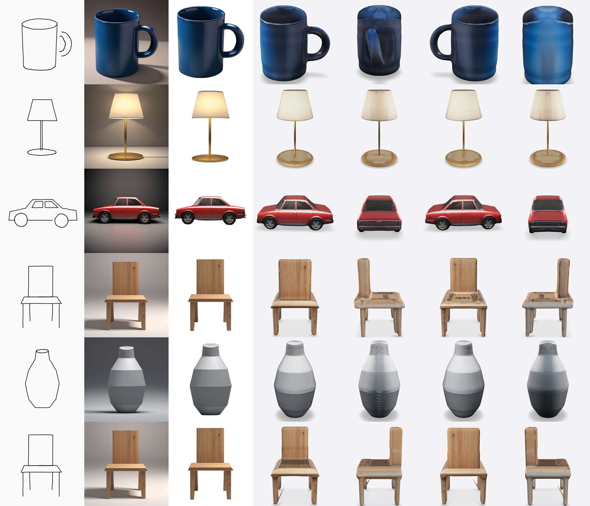

# Sketch2Shape: 2D sketch → textured 3D asset

Turn a single hand-drawn sketch (drawn in the app or uploaded) and an **optional** text prompt into a
**textured 3D model** you can orbit in the browser and download as **.glb** (embedded texture) or
**.obj + .mtl + .png** (zip). Runs fully locally with open models; no API keys.

## Architecture

```
 Sketchpad / Upload  +  optional prompt
        │
 1. Preprocess (OpenCV)      grayscale → polarity fix → denoise → adaptive threshold → speck removal
        │                    → crop to strokes → square pad → 512 px → stroke-width normalisation
        ▼
 2. Sketch-guided synthesis  DreamShaper-8 (SD1.5) + ControlNet v1.1 scribble + LCM-LoRA (6 steps)
        │                    prompt template forces "single object, white background, studio light"
        ▼
 3. Foreground isolation     rembg (IS-Net general) → alpha cleanup (largest blob) → recentre to 85 % of frame
        │                    self-check: silhouette IoU vs. the sketch; if < 0.55, regenerate with a new seed
        │                    and stronger sketch control (auto-retry), keep the best candidate
        ▼
 4. 3D reconstruction        TripoSR (triplane NeRF) on the image AND its mirror → density fields averaged
        │                    (flip ensemble, cancels one-sided bias)
        ▼
 4b. Hidden-side repair      candidates: none | round (lathe) | mirror-depth | mirror-lr, built on the density
        │  (automatic)       volume and scored by  0.45·outline agreement + 0.25·depth rank-correlation with
        │                    Depth Anything V2 + 0.30·CLIP zero-shot object-type prior (+ prompt keywords).
        │                    Parts outside a round body (handles, spouts) are kept. Best one wins.
        ▼
 4c. Mesh + texture          marching cubes (PyMCubes) → floaters removed → 60k-face decimation → Taubin smooth
        │                    → xatlas UV unwrap → CPU UV rasteriser → colour per texel: generated image projected
        │                    on camera-facing (and mirrored back) surfaces, TripoSR colour field elsewhere
        ▼
 5. Post + export            auto-straighten (undo camera pitch/roll) → normalise to 1 m, on ground
                             → .glb + .obj zip → re-open from disk and validate (validation.json)

 Fallback (any neural failure, or backend=geometric): silhouette inflation → watertight coloured mesh
```

Every stage is timed; timings, hardware, the fidelity score and the validation report are shown in the UI
and written to `outputs/<run>/run.json`.

## Install

Python 3.10 to 3.12. ~6 GB of weights, ~10 GB disk total.

```bash
python -m venv .venv
# Windows: .venv\Scripts\activate     Linux/macOS: source .venv/bin/activate

# 1) PyTorch for your hardware
pip install torch==2.4.1 torchvision==0.19.1 --index-url https://download.pytorch.org/whl/cu121   # NVIDIA
# or: pip install torch==2.4.1 torchvision==0.19.1 --index-url https://download.pytorch.org/whl/cpu

# 2) everything else
pip install -r requirements.txt

# 3) run it: on first start the app checks for the TripoSR source and every model and downloads
#    whatever is missing (~6 GB from Hugging Face + GitHub, one time). Later starts work offline.
python app.py
```

Windows one-shot: `setup_windows.bat` (does steps 1 to 2 with CUDA and pre-downloads the models).
To pre-download without starting the app: `python download_weights.py`. To skip the check: `--no-setup`.

## Run

```bash
python app.py                      # http://127.0.0.1:7860   (--share for a public link, --preload to warm up)
python run.py samples/car.png --prompt "red sports car"          # CLI
python run.py my_sketch.jpg --backend geometric                  # no-model fallback
python run.py samples/vase.png --shape-prior none                # disable hidden-side repair
python run.py samples/chair.png --prompt "wooden chair" --side samples/chair_side.png   # optional 2nd view
python tools/run_samples.py                                      # regenerate the sample gallery
```

## Results

Measured in the cloud test box: **CPU only, 4 × Intel Xeon threads, 15 GB RAM, no GPU** (Python 3.11, torch 2.4.1+cpu).
Defaults: 512 px, 6 LCM steps, ControlNet scale 0.9, seed 42, marching cubes 256³, 60k faces, 1024² texture.



*Columns: input sketch → generated image → foreground → 4 views of the exported GLB (front, right, back, left).*

Before the automatic hidden-side repair (plain TripoSR): [docs/gallery_before.png](docs/gallery_before.png). The lamp shade was flat from the side, the vase neck bent backwards and the mug rim was sheared.

| Sketch | Prompt | Auto shape prior | Outline IoU | Faces | Valid | Image gen (s) | 3D + repair + texture (s) | Total (s) |
|---|---|---|---|---|---|---|---|---|
| mug | ceramic coffee mug, glossy blue glaze | round | 0.861 | 60,000 | yes | 45 | 50 | 110 |
| lamp | table lamp with cream fabric shade and brass stand | round | 0.878 | 60,000 | yes | 45 | 38 | 84 |
| car | red sports car | mirror-depth | 0.89 | 59,998 | yes | 45 | 48 | 94 |
| chair | wooden chair | mirror-lr | 0.722 | 60,000 | yes | 45 | 40 | 86 |
| vase | (none) | round | 0.939 | 60,000 | yes | 44 | 44 | 90 |
| chair+side | wooden chair | mirror-lr+side-sketch | 0.722 | 59,998 | yes | 44 | 40 | 86 |

Warm-model total is **85 to 95 s per sketch on 4 CPU threads** (about 15 s of that is the flip ensemble; turn it off for ~72 s). First run adds model loading.
About 60 % of the time is the 6-step diffusion on CPU. On an NVIDIA GPU (even 4 GB with CPU offload) the
diffusion stage is expected to drop to a few seconds and TripoSR to about 1 s.

The geometric fallback (`--backend geometric`) produced a valid vertex-coloured GLB of the vase in 11 s.

## Model choices and attribution

| Stage | Model / library | Licence | Why |
|---|---|---|---|
| Image synthesis | [Lykon/dreamshaper-8](https://huggingface.co/Lykon/dreamshaper-8) (SD 1.5 fine-tune) | CreativeML OpenRAIL-M | Much cleaner product-style renders than base SD1.5 at the same cost |
| Sketch control | [lllyasviel/control_v11p_sd15_scribble](https://huggingface.co/lllyasviel/control_v11p_sd15_scribble) | OpenRAIL | Tolerant of rough, wobbly, unclosed strokes |
| Speed | [latent-consistency/lcm-lora-sdv1-5](https://huggingface.co/latent-consistency/lcm-lora-sdv1-5) | OpenRAIL++ | 4 to 8 steps instead of 30, makes CPU / 4 GB GPUs practical |
| Background removal | [rembg](https://github.com/danielgatis/rembg) IS-Net `isnet-general-use` (BiRefNet optional via `S2S_BG_MODEL=birefnet-general`) | MIT / Apache-2.0 | 0.6 s on CPU and keeps holes open (chair legs), where U²-Net filled them |
| Object type (symmetry prior) | [laion/CLIP-ViT-B-32-laion2B-s34B-b79K](https://huggingface.co/laion/CLIP-ViT-B-32-laion2B-s34B-b79K) | MIT | Zero-shot "is this a vase / car / chair..." in 0.3 s |
| Depth self-check | [Depth-Anything-V2-Small](https://huggingface.co/depth-anything/Depth-Anything-V2-Small-hf) | Apache-2.0 | 25M params, 0.4 s on CPU; scores which hidden-side shape agrees with the visible depth |
| Image → 3D | [TripoSR](https://github.com/VAST-AI-Research/TripoSR) ([weights](https://huggingface.co/stabilityai/TripoSR)) | MIT | Feed-forward (seconds), runs on CPU, good shape priors |
| Mesh / export | trimesh, xatlas, PyMCubes, fast-simplification, OpenCV | MIT / BSD | Validation, UV unwrap, marching cubes, decimation |
| UI | Gradio 4.44 (Sketchpad, Model3D) | Apache-2.0 | Canvas with brush / eraser / clear and an interactive 3D viewer |

## Limitations

- Single view: hidden sides are *plausible*, not exact. Symmetry repair covers round, mirror-depth and
  left-right symmetric objects; a genuinely asymmetric object (an animal turning its head) keeps TripoSR's guess.
- Round mode makes a lathe body: decorations that are only on one side are mirrored all round.
- Surfaces nobody can see (tops at eye level, sides at grazing angles) take TripoSR's softer colours.
- Thin structures (chair legs, lamp poles, handles) can come out thick or merged at 256³ marching cubes.
- Text prompt changes style/material/colour; the sketch outline controls the shape. A prompt that
  contradicts the sketch is resolved in favour of the sketch at high adherence.
- Prompt-free mode relies on the sketch alone; the class may be guessed wrong for very abstract shapes.

## Troubleshooting

| Symptom | Fix |
|---|---|
| `CUDA out of memory` on a 4 GB card | Automatic: SD uses CPU offload below 7 GB VRAM; TripoSR retries on CPU. Lower marching-cubes resolution to 192. |
| Generated object doesn't follow the sketch | Raise *Sketch adherence* to 1.1 to 1.3, or try 2 to 4 candidates (best IoU is kept). |
| Object cut off / multiple objects | Draw one closed outline, leave some margin; add a short prompt naming the object. |
| Weights download fails | Check access to huggingface.co; set `HF_HOME` or `S2S_WEIGHTS` to a drive with space. |
| Viewer shows nothing | Download the .glb and open in https://gltf-viewer.donmccurdy.com or Blender. |
